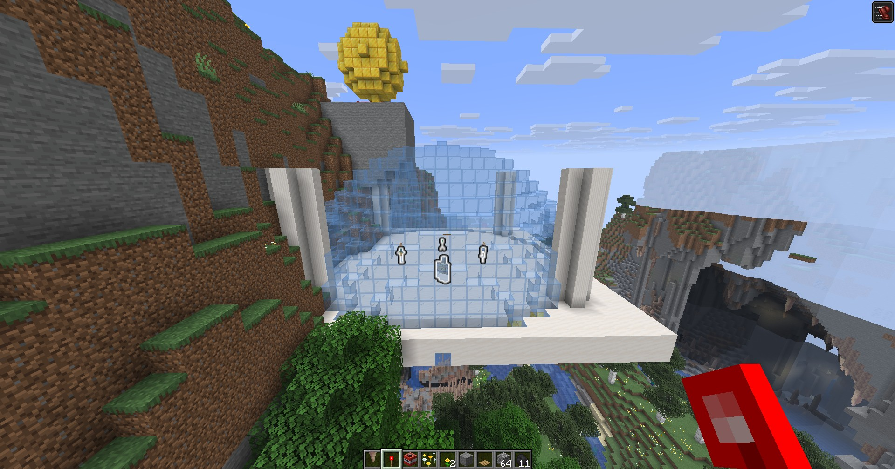

# Minecraft MCP

A Fabric mod for **Minecraft 26.3** that runs an MCP server inside the game JVM.
AI agents get tools to control the world: place blocks, build shapes, spawn mobs,
grant items, apply effects, control weather and time, and take screenshots.

```
   agent (any MCP client)
    │  JSON-RPC 2.0 over HTTP
    ▼
http://127.0.0.1:8765/mcp
    │  com.sun.net.httpserver (inside the game JVM)
    ▼
Minecraft main thread → ServerLevel / ServerPlayer
```

## What works today

Verified in-game: 31 tools, building a dome, a platform and columns, spawning mobs,
granting diamonds, speed and regeneration effects, changing time and weather, and a
1920×1009 screenshot.



The quartz platform, the glass dome, the four columns and the mobs inside were all
created through MCP calls.

## Installation

You need a **Fabric 26.3** build (Java 25).

```powershell
.\build.ps1        # build (finds JDK 25 and Gradle >= 9.8 itself)
.\deploy.ps1       # copy into mods/ and download the Fabric API
```

If the game is not installed in `%APPDATA%\.minecraft`, point at the directory explicitly:

```powershell
.\deploy.ps1 -GameDir 'D:\Games\.minecraft'
# or
$env:MINECRAFT_DIR = 'D:\Games\.minecraft'
```

`deploy.ps1` puts into `mods/`:

* `minecraft-mcp-1.0.0.jar` — the mod itself;
* `fabric-api-0.165.2+26.3.jar` — the Fabric API (the mod will not load without it).

> **After every build the jar has to be copied into `mods/` and the game restarted.**
> Take the file from `build/libs/minecraft-mcp-1.0.0.jar` (not `minecraft-mcp.jar` —
> that is a stale name from early builds). To check which build is actually loaded,
> call `mc_version`: it returns `mod_version`, `build_time` and `git_commit`.

Then start the game. The log should show:

```
Minecraft MCP: initializing (main), build 1.0.0 (2026-11-08T12:08:27Z, commit unknown)
Minecraft MCP: registered 31 tools
Minecraft MCP: listening on http://127.0.0.1:8765/mcp
```

Sanity check:

```powershell
curl http://127.0.0.1:8765/health
# {"status":"ok","name":"minecraft-mcp","worldLoaded":true,"tools":31}
```

## Connecting an MCP client

The server is a plain Streamable HTTP MCP endpoint, so any client can connect to it.
A client config entry (example for DSH):

```yaml
- id: mcp-minecraft
  name: '@deepseek-ai/dsh-mcp-client'
  config:
    serverName: minecraft
    transport: streamable-http
    url: http://127.0.0.1:8765/mcp
    failOnStartupError: false
```

After restarting the client the tools show up as `mcp__minecraft__*` (31 tools).
If the game is closed the server simply will not start — that does not affect the
other MCP servers thanks to `failOnStartupError: false`.

Verified against the official Python SDK (`mcp.client.streamable_http`): `initialize`,
`tools/list`, `tools/call` (`mc_get_world_info`, `mc_get_time`, `mc_send_message`) —
no errors.

For Cursor / Claude Desktop use a regular `mcp.json`:

```json
{
  "mcpServers": {
    "minecraft": { "url": "http://127.0.0.1:8765/mcp" }
  }
}
```

## Configuration

`config/minecraft-mcp.json` in the game directory is created on first launch:

```json
{
  "enabled": true,
  "bindAddress": "127.0.0.1",
  "port": 8765,
  "token": null,
  "maxBlocksPerCall": 65536,
  "maxEntitiesPerCall": 200,
  "allowRunCommand": true,
  "logRequests": false,
  "defaultEntityRadius": 64
}
```

| Field | Meaning |
|---|---|
| `bindAddress` | Listen on loopback only (the default). Exposing it to the network is not recommended. |
| `token` | When set, `Authorization: Bearer <token>` is required. |
| `maxBlocksPerCall` | Cap on blocks per call (protects against freezes). |
| `maxEntitiesPerCall` | Cap on entities per single spawn. |
| `allowRunCommand` | Allow `mc_run_command` (arbitrary commands). |

## Tools (31)

### Reading state

| Tool | What it does |
|---|---|
| `mc_version` | Mod version, build time, git commit, tool count |
| `mc_get_world_info` | Dimensions, time, weather, difficulty, players and their positions |
| `mc_get_player_state` | Position, HP, hunger, XP, gamemode, inventory, effects |
| `mc_get_block` | Block at a point: id, block-state properties, light |
| `mc_get_time` | Time in ticks, day, time of day |
| `mc_list_entities` | Entities nearby, filtered by type |

### Blocks and building

| Tool | What it does |
|---|---|
| `mc_set_block` | A single block (with properties: `axis`, `facing`, …) |
| `mc_fill_blocks` | Fill a volume: `replace`, `keep`, `hollow`, `outline`, `destroy` |
| `mc_batch_set_blocks` | An array of blocks in one call |
| `mc_clone_region` | Copy a region with an offset (like `/clone`) |
| `mc_replace_blocks` | Replace one block type with another inside a region |
| `mc_build_shape` | Sphere, dome, cylinder, pyramid, torus, wall, platform, hollow box |
| `mc_draw_block_art` | Block pixel art from an ASCII pattern (planes `xy`, `xz`, `yz`) |

**`mc_fill_blocks` modes:**

| Mode | Behaviour |
|---|---|
| `replace` | Replaces everything in the region |
| `keep` | Places only into air, existing blocks are left alone |
| `hollow` | The whole surface of the box (walls, floor, ceiling), interior untouched. 98 blocks for a 5³ cube |
| `outline` | The 12 edges only (two or more coordinates on the boundary). 44 blocks for a 5³ cube |
| `destroy` | Breaks existing blocks with drops, no new block is placed |

**Block-state properties are validated strictly.** An unknown property name is an
error that lists the available ones instead of being silently skipped:

```json
{"block":"minecraft:oak_log","properties":{"nosuchprop":"y"}}
→ Unknown property 'nosuchprop' for minecraft:oak_log; available: axis
```

The same applies to an invalid value: `Invalid value 'q' for property axis; available: x, y, z`.
In `mc_batch_set_blocks` the error rejects the whole call and names the index: `blocks[2]: ...`.

### Entities

| Tool | What it does |
|---|---|
| `mc_spawn_entity` | Spawn mobs: count, spread, name, glow, no-AI, health |
| `mc_list_entities` | Search: type, position, health, UUID |
| `mc_kill_entities` | Remove by UUID, type or radius |
| `mc_entity_action` | Glow, health, scale, AI, rename, ignite, remove |

### Player

| Tool | What it does |
|---|---|
| `mc_teleport_player` | Teleport (including across dimensions) |
| `mc_set_player_attributes` | Gamemode, HP, hunger, XP, flight, invulnerability |
| `mc_give_item` | Grant items (with a custom name) |
| `mc_clear_inventory` | Clear the inventory |
| `mc_set_effects` | Potion effects with duration and amplifier |
| `mc_clear_effects` | Remove all effects |

### World and effects

| Tool | What it does |
|---|---|
| `mc_set_time` / `mc_get_time` | Time of day |
| `mc_set_weather` | Clear / rain / thunder with a duration |
| `mc_set_difficulty` | Difficulty |
| `mc_run_command` | Any server command (escape hatch) |
| `mc_send_message` | Chat, actionbar, title, subtitle |
| `mc_spawn_particles` | A cloud of particles |
| `mc_play_sound` | A sound at a point |
| `mc_fx` | Lightning, explosion, firework |
| `mc_screenshot` | PNG screenshot as base64 |

## Agent examples

A roomy house, turnkey:

```json
mc_fill_blocks  {"from":{"x":0,"y":64,"z":0},"to":{"x":15,"y":72,"z":15},"block":"minecraft:stone_bricks","mode":"hollow"}
mc_fill_blocks  {"from":{"x":1,"y":64,"z":1},"to":{"x":14,"y":71,"z":14},"block":"minecraft:air"}
mc_build_shape  {"shape":"pyramid","x":7,"y":73,"z":7,"block":"minecraft:dark_oak_planks","radius":8,"height":6}
```

An arena with mobs:

```json
mc_build_shape   {"shape":"dome","x":100,"y":70,"z":100,"block":"minecraft:glass","radius":12}
mc_spawn_entity  {"type":"minecraft:zombie","x":95,"y":71,"z":100,"count":5,"glowing":true}
mc_set_effects   {"effects":[{"id":"minecraft:strength","duration_seconds":300,"amplifier":4}]}
```

A sign made of blocks:

```json
mc_draw_block_art {
  "x": 10, "y": 70, "z": 0, "axis": "xy",
  "rows": ["####  ##", "#  #   #", "####   #", "#     # ", "#    ## "],
  "palette": {"#": "minecraft:gold_block"}
}
```

## Development

```
src/main/java/dev/mcpcraft/
├── McpCraftMod.java            main entrypoint
├── mcp/                        JSON-RPC, HTTP server, tool registry
├── tools/                      tool sets
├── util/                       world access, argument parsing, main thread
└── config/                     configuration
src/client/java/dev/mcpcraft/client/
├── McpCraftClient.java         client entrypoint: starts HTTP, world events
├── ClientTools.java            client-side tools (screenshot)
└── ScreenshotBridge.java       frame capture on the client tick
```

Build notes for 26.3:

* **There are no Yarn mappings for 26.x** — the game ships unobfuscated, so `mappings`
  are not declared in `build.gradle`.
* You need **Gradle ≥ 9.8** (required by Loom 1.19) and **JDK 25**.
* `build.ps1` looks for JDK 25 in `JAVA_HOME`, in the launcher runtime and in the
  standard install directories; for Gradle it checks `GRADLE_HOME`, the wrapper cache
  and `PATH`. If autodetection fails, pass the paths explicitly:

```powershell
.\build.ps1 -JavaHome 'C:\jdk-25' -Gradle 'C:\gradle\bin\gradle.bat'
```

```powershell
.\build.ps1 -Task test     # 27 tests
.\build.ps1                # build the jar
```

### Launching the game directly

`scripts/launch-minecraft.ps1` builds the classpath from the version JSON, extracts the
natives and starts the client without the GUI launcher (handy for debugging):

```powershell
.\scripts\launch-minecraft.ps1 -GameDir 'D:\Games\.minecraft'
```

### Acceptance test

```powershell
python scripts/smoke_mcp.py                 # full run, needs an open world
python scripts/smoke_mcp.py --skip-visual   # protocol only
```

## Security

* The server listens on **`127.0.0.1` only**; it is not reachable from the local network.
* Every game operation runs on the main thread with a 30 s timeout.
* Block and entity limits protect against accidentally filling half the world.
* `allowRunCommand: false` disables arbitrary commands entirely.
* A `token` adds Bearer authorization for shared machines.

## License

MIT — see [LICENSE](LICENSE).
